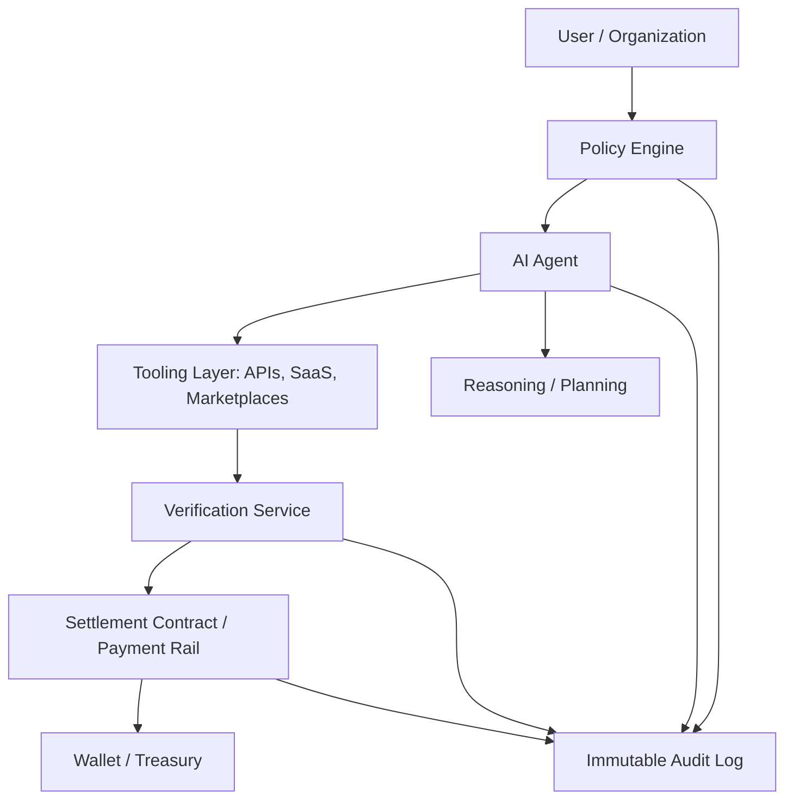

---
title: Machine Economies and Agent Labor
repo: future-of-ai-and-web3
primary_keyword: AI Agents
secondary_keywords:
- Future of AI
- Autonomous Commerce
- Digital Economies
slug: machine-economies-and-agent-labor
word_count_target: 1200
commit_type: 'research(ai):'---

# Machine Economies and Agent Labor

## Introduction

**AI Agents** are moving beyond chat interfaces and into operational roles: negotiating prices, executing workflows, coordinating services, and completing transactions without human intervention. This shift is the foundation of machine economies, where software agents can earn, spend, and exchange value. For founders and CTOs, the topic is no longer theoretical. It affects product design, payment rails, identity, compliance, and the economics of digital labor.

The key question is not whether agents can act autonomously, but how to structure their labor so it is reliable, auditable, and profitable. In the context of the **Future of AI**, agent labor becomes a new production layer: machines performing tasks once reserved for humans or centralized applications. That creates opportunities in **Autonomous Commerce**, but only if the system can handle trust, incentives, and coordination at scale.

## Problem Statement

Traditional software is deterministic: it executes predefined logic and depends on human operators for decisions, approvals, and payments. AI agents break that model. They can adapt to context, but they also introduce uncertainty. A single agent may hallucinate a vendor, overspend a budget, or complete an action that is technically valid but economically harmful.

This creates four core problems:

1. **Identity and authorization**: An agent needs a verifiable identity to sign actions, access APIs, and prove ownership of a wallet or service account.
2. **Economic settlement**: If agents are to perform labor, they need payment mechanisms that support microtransactions, streaming payments, escrow, and refunds.
3. **Coordination**: Multi-agent workflows require task allocation, conflict resolution, and shared state without introducing a centralized bottleneck.
4. **Accountability**: Leaders need audit trails showing what the agent knew, what it decided, and why a transaction was executed.

Without a proper framework, machine economies become fragile. The risk is not just technical failure; it is loss of trust. In **Digital Economies**, trust is the substrate that determines whether agents can participate as first-class economic actors.

## Solution

The practical solution is to treat **AI Agents** as economic entities with constrained authority, measurable outputs, and programmable payment logic. Instead of giving an agent full control, design a layered system:

- **Identity layer**: each agent gets a cryptographic identity linked to a wallet, API keys, and permissions.
- **Policy layer**: budget ceilings, approval thresholds, and allowed actions are enforced before execution.
- **Execution layer**: the agent interacts with tools, marketplaces, and smart contracts.
- **Settlement layer**: value transfer happens automatically when work is verified.
- **Audit layer**: every action is logged with timestamps, prompts, tool calls, and on-chain events.

A useful operating model is “task, proof, pay.” The agent receives a task, produces a proof of completion, and is paid only when verification passes. Proof can be a signed receipt, an API response, a human approval, or an on-chain condition such as delivery confirmation.

For founders, this changes product strategy. You are not building a chatbot with a wallet attached. You are building a labor system where agents can be hired, monitored, and compensated. That opens use cases such as procurement agents, customer support agents, research agents, and treasury agents.

## Architecture or Framework

A robust machine economy architecture should separate decision-making from value transfer. The following framework is a practical starting point:

### 1. Identity and permissions
Assign each agent a unique identity, ideally backed by a wallet and a machine-readable permission set. Use scoped credentials rather than master keys. For example, an agent may be allowed to spend up to $200 per day on vendor APIs but cannot approve vendor onboarding.

### 2. Task orchestration
Use a queue or workflow engine to manage jobs. A task should include:
- objective
- budget
- deadline
- acceptable tools
- verification criteria

This prevents agents from improvising outside their mandate.

### 3. Verification
Verification is the most important control point. In machine economies, payment should depend on evidence, not just completion claims. Verification can be:
- deterministic API checks
- human review for high-risk actions
- smart contract conditions
- reputation scores from prior executions

### 4. Settlement
Settlement can happen through stablecoins, internal credits, or tokenized balances. For **Autonomous Commerce**, micropayments matter because many agent tasks are small and frequent. Streaming payments or pay-per-call models are often better than monthly invoicing.

### 5. Observability
Log prompts, tool calls, outputs, approvals, and payment events. Track metrics such as:
- task success rate
- average cost per completed task
- verification failure rate
- time-to-settlement
- exception rate per agent

These metrics tell you whether the agent labor market is economically viable.

## Benefits

The main benefit of machine economies is scalability without linear headcount growth. A well-governed agent can operate 24/7, handle repetitive work, and respond instantly to market changes. For startups, this can compress operating costs and speed up execution.

Other benefits include:

- **Lower transaction costs**: Agents can negotiate and execute smaller tasks that are too expensive for human labor.
- **Faster market response**: AI Agents can monitor prices, inventory, and demand, then act immediately.
- **Composable workflows**: One agent can source data, another can validate it, and a third can settle payment.
- **Global participation**: Agents do not need visas, payroll onboarding, or human time zones.
- **New business models**: Products can charge per action, per outcome, or per verified result rather than per seat.

For the **Future of AI**, this is a major shift. The economic unit is no longer just the user or employee; it is also the agent. That expands the design space for marketplaces, SaaS, and protocol-based services.

## Challenges

Machine economies are promising, but the risks are real.

### Security
If an agent is compromised, it may spend funds, leak credentials, or trigger malicious actions. Strong key management, rate limits, and transaction approvals are essential. Never give an agent unrestricted wallet access.

### Hallucination and error
Agents can generate plausible but wrong outputs. In labor systems, that means wasted spend or broken workflows. Use constrained tools, deterministic checks, and fallback rules for high-value actions.

### Compliance
Agent-driven payments and on-chain activity may trigger KYC, AML, tax, and recordkeeping obligations. Leaders should involve legal and compliance teams early, especially when agents interact with external counterparties.

### Incentive design
If an agent is paid only for volume, it may optimize for speed over quality. If it is paid only for success, it may avoid difficult but valuable tasks. Good incentive design balances throughput, accuracy, and risk.

### Interoperability
A fragmented ecosystem of wallets, identity systems, and APIs can make agent labor hard to scale. Standards for agent identity, permissioning, and receipts will matter as much as model quality.

## Future Opportunities

The next phase of **Digital Economies** will likely include agent-native markets. Instead of humans browsing service providers, agents will discover, negotiate, and purchase services from other agents. This creates several opportunities:

- **Agent marketplaces**: platforms where specialized agents sell verified services such as research, lead qualification, or procurement.
- **On-chain identity for agents**: reusable identities that carry reputation, permissions, and payment history across applications.
- **Autonomous supply chains**: agents that reorder inventory, settle invoices, and coordinate logistics based on real-time conditions.
- **Machine-to-machine finance**: wallets, credit, and escrow designed specifically for autonomous systems.
- **Reputation-based labor markets**: agents with strong execution records gain better access to higher-value tasks and lower fees.

As these systems mature, the distinction between software and labor will blur. The most valuable companies may not just deploy **AI Agents**; they will manage fleets of them with measurable productivity, controlled risk, and programmable compensation.

## Conclusion

Machine economies are not a speculative side project; they are an emerging operating model for the **Future of AI**. As **AI Agents** take on economic roles, the winners will be organizations that design for identity, verification, settlement, and accountability from the start.

For founders and CTOs, the strategic move is clear: build agent labor systems with constrained permissions, robust auditability, and payment tied to verified outcomes. That is how **Autonomous Commerce** becomes reliable, and how **Digital Economies** evolve from human-centric platforms into mixed human-machine markets.

The companies that succeed will not simply automate tasks. They will create the infrastructure where agents can work, earn, and coordinate safely at scale.

## Related Reading

- (pending)