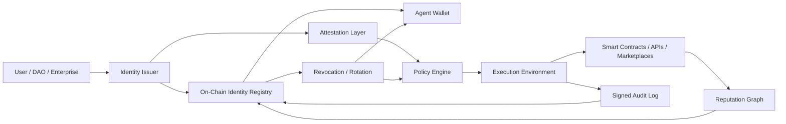

---
title: On-Chain Identity for AI Agents
repo: future-of-ai-and-web3
primary_keyword: On-Chain Identity
secondary_keywords:
- Web3 Research
- Decentralized AI
- Emerging Technology
slug: on-chain-identity-for-ai-agents
word_count_target: 1200
commit_type: 'research(ai):'---

# On-Chain Identity for AI Agents

## Introduction

**On-Chain Identity** is becoming a foundational primitive for AI agents that need to transact, authenticate, and coordinate across decentralized networks. As AI systems move from isolated tools to autonomous participants in digital markets, they need more than API keys and server-side logs. They need verifiable identity, persistent reputation, and policy-bound permissions that can be inspected by humans and systems alike.

For founders and technical leaders, the key question is not whether AI agents will operate on-chain, but how to make them accountable. In **Web3 Research**, identity is often treated as a wallet address. For AI agents, that is not enough. An agent may control multiple wallets, rotate infrastructure, or act on behalf of a user, DAO, or organization. A practical **On-Chain Identity** model must bind agent behavior to cryptographic credentials, attestations, and revocation mechanisms.

This matters for **Decentralized AI** because autonomous agents will increasingly buy services, access data, manage assets, and negotiate with other agents. Without identity, there is no trust. Without trust, there is no scalable agent economy.

## Problem Statement

Current identity patterns were designed for humans or for static software services, not for autonomous agents. A server can be authenticated with an API key, but an AI agent is different in three ways:

1. It can act continuously and across many contexts.
2. It may need delegated authority with limited scope.
3. It can be replicated, forked, or rehydrated from checkpoints.

This creates several operational risks:

- **No durable reputation:** A wallet address alone does not express whether an agent has completed tasks reliably, been slashed, or earned trust.
- **Weak delegation controls:** Users need to grant agents constrained permissions, such as spending caps, domain restrictions, or time-limited access.
- **Poor attribution:** If an agent signs a transaction, there must be a way to distinguish the agent from the operator, the model provider, and the hosting environment.
- **Sybil resistance gaps:** Agent swarms can create many identities cheaply unless issuance is tied to verifiable credentials or economic cost.
- **Revocation complexity:** If an agent is compromised, its identity must be invalidated without breaking the broader system.

These issues are not theoretical. In an agent economy, identity is the difference between a useful autonomous participant and an unaccountable bot. For **Emerging Technology** teams, the architecture must support both machine speed and governance-grade auditability.

## Solution

A workable **On-Chain Identity** system for AI agents should combine four layers:

1. **Cryptographic control**
   - Each agent gets one or more wallets or keypairs.
   - Keys should be stored in secure enclaves, MPC wallets, or hardware-backed modules.
   - The agent signs every material action, including transactions and policy-relevant messages.

2. **Verifiable issuance**
   - Identity is not self-asserted alone.
   - A registrar, DAO, enterprise controller, or identity protocol issues attestations about the agent:
     - model class
     - owner
     - scope of authority
     - creation time
     - risk tier
   - Standards such as Verifiable Credentials or on-chain attestations can encode this trust.

3. **Scoped delegation**
   - The agent receives permissions through smart contracts or policy engines.
   - Examples:
     - spend up to 0.5 ETH per day
     - interact only with whitelisted contracts
     - call only specific tools
     - operate only during a time window
   - This prevents overreach while preserving autonomy.

4. **Reputation and revocation**
   - Completed tasks, disputes, and slashing events should be written to an identity graph or reputation registry.
   - Revocation should be immediate and machine-readable.
   - The system must support key rotation, re-issuance, and emergency freeze.

A strong design separates identity from execution. The model may change, the host may change, and the wallet may change, but the identity record should preserve continuity through attestations and lineage.

## Architecture or Framework

A practical framework for **On-Chain Identity** for AI agents can be built with the following components:

- **Agent Wallet**
  - Holds funds and signs transactions
  - Can be a smart contract wallet for policy enforcement
- **Identity Registry**
  - Stores agent IDs, metadata hashes, and status flags
  - Supports issuance, update, and revocation
- **Attestation Layer**
  - Records owner, model provenance, and permissions
  - Can use EAS-style attestations or similar registries
- **Policy Engine**
  - Enforces spend limits, contract allowlists, and time-based constraints
  - May run on-chain or off-chain with on-chain verification
- **Reputation Graph**
  - Tracks task completion, disputes, and trust scores
  - Aggregates signals from multiple protocols
- **Audit Log**
  - Stores signed actions and proofs for forensic review

### Implementation steps

1. **Create an agent identity schema**
   - Define fields such as agent type, owner, model hash, risk tier, and permission scope.
2. **Issue a wallet and attestations**
   - Bind the wallet to the agent record using signed credentials.
3. **Route actions through a policy layer**
   - Require authorization checks before any transfer or contract call.
4. **Write action receipts**
   - Store hashes of executed actions, timestamps, and counterparties.
5. **Update reputation continuously**
   - Score completion rate, dispute rate, and policy violations.
6. **Enable revocation and rotation**
   - Support emergency deactivation and migration to a new keypair.

### Design trade-offs

- Smart contract wallets improve safety but add gas costs and latency.
- Off-chain policy engines are faster but require careful trust assumptions.
- Rich reputation systems improve discovery but can create privacy concerns.
- Public identity records aid transparency but may expose operational patterns.

## Benefits

A robust **On-Chain Identity** framework for AI agents creates measurable advantages:

- **Accountability:** Every meaningful action can be tied to a verifiable agent record.
- **Permissioned autonomy:** Agents can operate without human approval for each step while staying within policy.
- **Interoperability:** Other protocols can trust the same identity primitive instead of rebuilding custom auth.
- **Composable reputation:** A good agent can carry trust across marketplaces, DAOs, and services.
- **Fraud reduction:** Signed identity and attestation layers make impersonation and replay attacks harder.
- **Economic coordination:** Agents can participate in auctions, escrow, staking, and service markets with enforceable rules.

From a business perspective, this reduces integration friction. Product teams can expose autonomous features without surrendering control. Security teams gain audit trails. Governance teams gain revocation. In **Decentralized AI**, these are not optional features; they are prerequisites for scale.

## Challenges

Several challenges remain before **On-Chain Identity** becomes a standard for AI agents:

- **Privacy vs. transparency**
  - Public identity can reveal strategy, customer relationships, or operational cadence.
  - Selective disclosure and zero-knowledge proofs may be needed.
- **Identity sprawl**
  - Agents may need multiple identities for different roles, chains, or clients.
  - Systems must define when identities should be linked versus isolated.
- **Key management**
  - Autonomous systems are only as safe as their signing infrastructure.
  - Compromise of a single key can cause financial and reputational damage.
- **Reputation manipulation**
  - Agents may collude to inflate trust scores or fake task completion.
  - Reputation must be anchored in verifiable outcomes, not just self-reports.
- **Cross-chain fragmentation**
  - Identity may be recognized on one network but invisible on another.
  - Standards for portable attestations are still maturing.
- **Legal and governance ambiguity**
  - It is still unclear how liability should be assigned when an agent acts under delegated authority.

For leaders building in this space, the main risk is overdesigning identity before use cases are proven. Start with the minimum identity surface needed for a specific workflow, then expand as trust requirements grow.

## Future Opportunities

The next phase of **On-Chain Identity** for AI agents will likely combine identity with machine-readable policy and economic incentives. Several opportunities stand out:

- **Agent passports**
  - Portable identity bundles that include ownership, capabilities, risk tier, and reputation history.
- **Programmable delegation**
  - Users can issue limited-scope authority that expires automatically or changes based on conditions.
- **Machine-verifiable provenance**
  - Models, datasets, prompts, and toolchains can be linked to agent identity for auditability.
- **Identity-backed agent marketplaces**
  - Buyers can filter agents by reputation, specialization, and compliance status.
- **ZK-enabled privacy layers**
  - Agents can prove authorization or compliance without exposing full operational details.
- **Inter-agent credit systems**
  - Reputation and escrow can support lending, prepayment, and service guarantees between autonomous actors.

For **Emerging Technology** strategists, this suggests a broader digital economy where identity is not just authentication. It becomes a coordination layer for value exchange, compliance, and machine trust.

## Conclusion

**On-Chain Identity** is a necessary building block for AI agents that operate in decentralized environments. Wallet ownership alone is insufficient; agents need cryptographic control, verifiable issuance, scoped delegation, reputation, and revocation. The best systems will separate identity from execution while keeping both auditable.

For founders and CTOs, the practical path is to start with a narrow agent workflow, define the required trust boundaries, and implement identity as a layered system rather than a single token or address. That approach supports safer autonomy, better governance, and more portable trust across the emerging agent economy.

## Related Reading

- (pending)