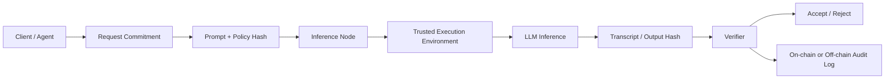

---
title: Verifiable Inference for LLMs
repo: future-of-ai-and-web3
primary_keyword: Decentralized AI
secondary_keywords:
- Future of AI
- Emerging Technology
- AI Governance
slug: verifiable-inference-for-llms
word_count_target: 1200
commit_type: 'research(ai):'---

# Verifiable Inference for LLMs in Decentralized AI

## Introduction

Verifiable inference for LLMs is becoming a core requirement for **Decentralized AI** systems that need trust without relying on a single cloud provider. In centralized deployments, users generally accept that the model, weights, and execution environment are controlled by one operator. In decentralized settings, that assumption breaks down. Multiple nodes may host the model, route requests, or execute parts of the inference pipeline, and each participant may have different incentives.

For founders and technical leaders, the key question is simple: how can a client prove that an LLM produced a specific output from a specific model under a specific policy, without trusting the serving node? This matters for agent economies, on-chain workflows, regulated decision support, and any product where model outputs trigger financial, operational, or governance actions.

Verifiable inference addresses that trust gap by attaching cryptographic or protocol-level evidence to model execution. Instead of asking users to trust the server, the system produces proof that the inference was performed correctly, or at least that it followed a verifiable execution path. This is especially relevant for the **Future of AI**, where model access, identity, and accountability are increasingly distributed across networks rather than controlled by one vendor.

## Problem Statement

LLM inference is hard to verify because the output is probabilistic, the execution stack is complex, and the model may be too large to prove naively. A standard transformer inference run involves tokenization, embedding lookup, attention layers, matrix multiplications, sampling, and post-processing. Any of these stages can be altered by a malicious or buggy operator.

In **Decentralized AI**, the verification problem shows up in several forms:

1. **Model substitution**: a node claims to run one model but serves a smaller, cheaper, or biased alternative.
2. **Execution tampering**: the model is correct, but the operator changes prompts, system instructions, temperature, or stop conditions.
3. **Output fabrication**: a node returns a plausible answer without actually running inference.
4. **State inconsistency**: different replicas produce different outputs because of nondeterminism, version drift, or hidden configuration changes.
5. **Policy bypass**: safety filters, access controls, or audit logging are removed before the output is returned.

These issues are not theoretical. In agent-based systems, a single bad inference can trigger a payment, publish a transaction, or update a shared knowledge base. Without verifiable inference, the system cannot reliably distinguish between a valid response and a forged one. That weakens **AI Governance**, complicates compliance, and reduces confidence in **Emerging Technology** stacks that depend on autonomous model behavior.

## Solution

The practical solution is to design inference systems that can prove one or more of the following:

- The model identity is authentic.
- The prompt and configuration were not tampered with.
- The execution occurred inside a trusted environment.
- The output matches a committed computation or transcript.
- The result was accepted only after verification.

There is no single universal method. Most production-ready designs combine multiple techniques depending on latency, cost, and trust assumptions.

### Common approaches

- **Trusted Execution Environments (TEEs)**  
  Run the model inside hardware-backed enclaves such as Intel SGX, AMD SEV, or AWS Nitro Enclaves. The enclave can produce remote attestation showing that approved code and model hashes were loaded.

- **Zero-knowledge proofs (ZKPs)**  
  Generate cryptographic proofs that a computation was executed correctly. This is strongest in theory, but proving full LLM inference at scale remains expensive.

- **Commitment schemes and transcript hashing**  
  Commit to the prompt, model version, sampling parameters, and intermediate checkpoints. This does not prove the entire computation, but it makes tampering detectable.

- **Redundant execution and consensus**  
  Multiple independent nodes run the same inference and compare outputs. This improves confidence, though it increases cost and is sensitive to nondeterminism.

- **Verifiable sampling and deterministic decoding**  
  Constrain decoding to deterministic or partially deterministic methods so that the same input produces the same output under the same model state.

A strong implementation usually starts with TEEs plus commitments, then adds selective cryptographic proofs for high-value workflows. For example, an on-chain credit decision or autonomous trade approval may justify stronger guarantees than a casual chatbot reply.

## Architecture or Framework

A useful framework for verifiable inference in **Decentralized AI** is a four-layer architecture: request integrity, execution integrity, proof generation, and verification.

### 1. Request integrity

The client submits:

- prompt text
- system instructions
- model identifier
- decoding parameters
- policy constraints
- nonce or timestamp

These are hashed into a request commitment. This prevents later disputes about what was actually asked.

### 2. Execution integrity

The inference node loads the approved model artifact and runs inside a TEE or another controlled environment. The environment should expose:

- model hash
- container image hash
- enclave measurement
- runtime configuration
- signed attestation

This step is critical for **AI Governance** because it creates a machine-readable record of what code and weights were used.

### 3. Proof generation

The node returns:

- raw output
- proof artifact
- attestation statement
- transcript hash
- optional intermediate trace

If using TEEs, the proof is an attestation signed by the hardware root of trust. If using ZK methods, the proof may verify that the output was produced by a specific circuit. For many teams, attestation is enough for an initial deployment, while ZK is reserved for higher-assurance paths.

### 4. Verification

A verifier checks:

- the attestation signature
- the model hash against an allowlist
- the prompt commitment
- the policy hash
- freshness of the response
- output consistency with the expected execution path

If the checks pass, the response is accepted. Otherwise, the client can reject the result, request a retry, or route the same request to another node.

### Implementation pattern

A practical stack might look like this:

- **Orchestration**: Kubernetes or a decentralized compute scheduler
- **Attestation**: Nitro Enclaves, SGX, or SEV
- **Model serving**: vLLM, TensorRT-LLM, or TGI
- **Identity**: wallet-based node identity plus signed node certificates
- **Audit trail**: append-only logs or a blockchain anchor
- **Policy engine**: OPA or custom rules for prompt/output constraints

This setup supports a verifiable inference workflow without forcing every token to be proven via ZK. That trade-off is important because current proof systems are still too costly for many production LLM workloads.

## Benefits

Verifiable inference creates concrete value across product, security, and compliance dimensions.

### Trust without central control

Users can verify model execution even when the provider is unknown or distributed. This is one of the main promises of **Decentralized AI**: trust is derived from proofs, not brand reputation.

### Better AI Governance

Organizations can prove which model version produced a decision, which prompt was used, and whether the output came from an approved execution environment. That improves auditability, incident response, and policy enforcement.

### Reduced fraud and manipulation

Nodes cannot easily fabricate outputs or silently swap models if the system checks attestation and commitments. This is important for marketplaces, prediction systems, and agent economies where responses have financial consequences.

### Stronger interoperability

Verified outputs can be consumed by other agents, smart contracts, or downstream services with less manual review. This supports the **Future of AI** where machine outputs become inputs to other autonomous systems.

### Clearer accountability

When something goes wrong, operators can trace the failure to the model, the runtime, the prompt, or the verifier. That reduces ambiguity and helps teams debug issues in **Emerging Technology** deployments.

## Challenges

Verifiable inference is promising, but it is not free.

### Latency overhead

TEEs add attestation and enclave communication overhead. ZK proofs add even more cost. For interactive chat, extra latency may be acceptable only if the trust requirement is high.

### Determinism is difficult

LLMs are often nondeterministic due to sampling, floating-point behavior, and hardware differences. Verification becomes much easier if decoding is constrained, but that can reduce creativity and response quality.

### Large-model proof complexity

Proving full inference for frontier-scale LLMs is still expensive. Even if the proof system is correct, it may not be operationally viable for high-throughput workloads.

### Hardware trust assumptions

TEEs reduce trust in the operator, but they shift trust to hardware vendors and their security models. A robust design should treat attestation as a strong signal, not absolute truth.

### Key management and revocation

If node identities, attestation keys, or model signing keys are compromised, the entire verification chain weakens. Teams need rotation, revocation, and incident response procedures.

### UX and developer complexity

Verification adds steps to request handling, retries, and monitoring. Product teams must decide which flows require proof and which can use normal inference to avoid overengineering.

## Future Opportunities

The next phase of verifiable inference will likely combine hardware, cryptography, and protocol design more tightly.

### Incremental proof systems

Rather than proving the entire model run, systems may prove only high-risk segments such as policy checks, tool calls, or final decision layers. This would make verification more practical for real-time applications.

### Proof-aware model architectures

Future models may be designed with verification in mind, using architectures that are easier to attest or prove. This could include modular inference graphs, deterministic subroutines, or proof-friendly quantization.

## Conclusion

Verifiable Inference for LLMs is not solved by adding more automation alone. Teams need explicit policies, human checkpoints for high-impact decisions, and auditable controls around **Decentralized AI** before scaling agent workflows. Future models may be designed with verification in mind, using architectures that are easier to attest or prove. This could include modular inference graphs, deterministic subroutines, or proof-friendly quantization. Start with a narrow pilot, measure override rates and incident response weekly, and expand scope only after governance controls prove reliable in production.

## Related Reading

- (pending)